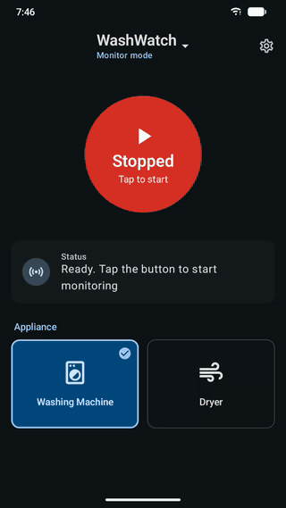
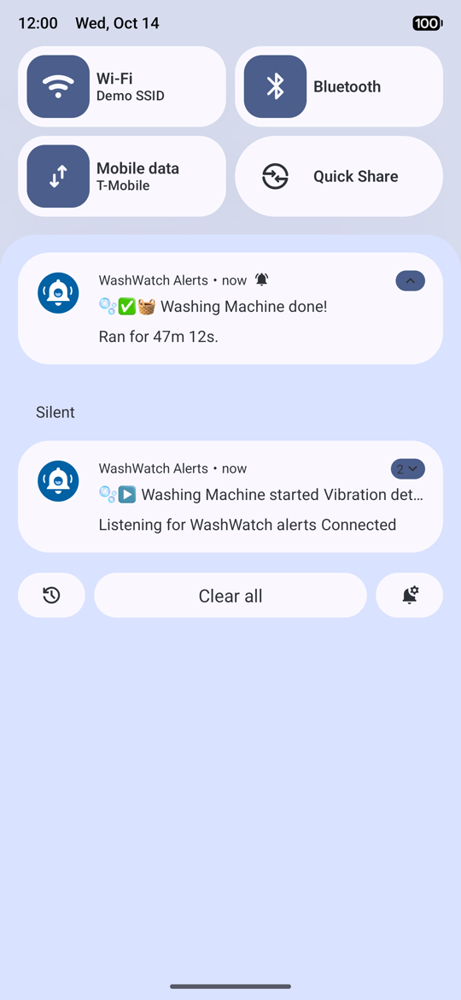
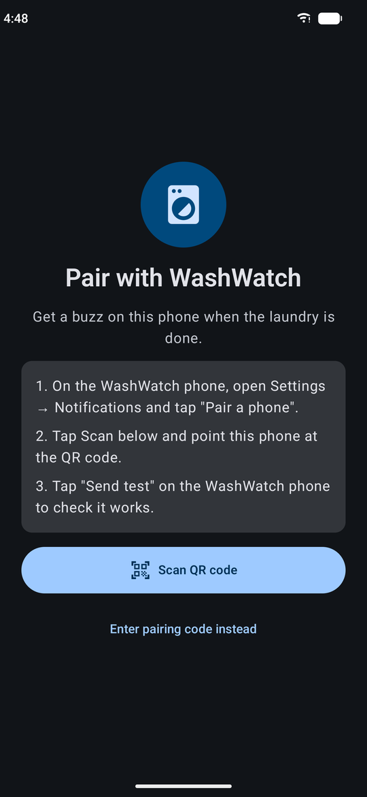
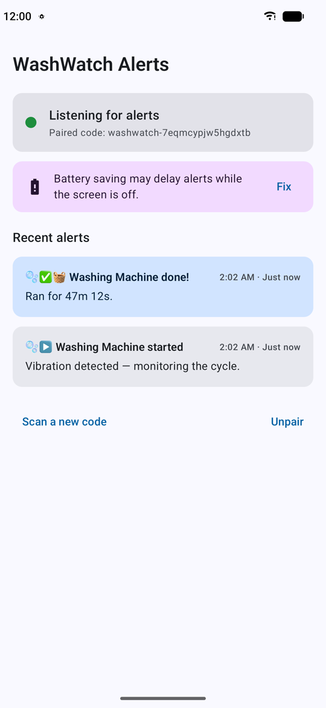

# WashWatch

**Know when your laundry is done, without walking downstairs to check.**

In every apartment I've lived in, the washing machine has been on the ground floor, and I never am. So I'd either guess at the cycle time and go down too early, or forget and leave wet clothes sitting in the machine. I built WashWatch to fix that. A spare Android phone sits on the washer, feels the vibration, and my everyday phone buzzes when the cycle finishes.

No smart plug, no cloud account, no extra hardware. Just a spare phone and some double-sided tape.

<p align="center">
  
  &nbsp;&nbsp;
  
</p>

## How it works

**WashWatch in Monitor mode (phone on the machine) → private ntfy.sh topic → WashWatch in Alerts mode (your phone)**

[WashWatch](WashWatch/) is one app with two modes. Install it on both phones; on first launch it asks where the phone is, and you can switch any time from the menu under the app name at the top of the screen.

| Mode | Runs on | What it does |
|---|---|---|
| **Monitor** ("On the machine") | A spare phone stuck to the washer or dryer (the *host*) | Reads the accelerometer, detects when a cycle starts and finishes, and publishes an alert |
| **Alerts** ("With me") | Your everyday phone (the *client*) | Listens for those alerts and shows them as notifications |

Switching modes only changes the screen: a started monitor keeps monitoring and a paired phone keeps listening.

```
 ┌──────────────┐  vibration   ┌──────────────┐   HTTPS    ┌─────────┐   stream   ┌──────────────────┐
 │   Washer /   │ ───────────▶ │  WashWatch   │ ─────────▶ │ ntfy.sh │ ─────────▶ │ WashWatch Alerts │
 │    Dryer     │              │ (host phone) │  publish   │  topic  │  subscribe │  (your phone)    │
 └──────────────┘              └──────────────┘            └─────────┘            └──────────────────┘
```

The two phones talk through a private, randomly named [ntfy.sh](https://ntfy.sh) topic. No account, no Firebase, no Google Play Services.

### Detection

1. **Calibrate.** With the machine off, WashWatch measures the background vibration for a few seconds. It sets the trigger threshold at a multiple of the peak it sees: 3× by default, adjustable from 1.5× to 10× in settings (lower is more sensitive).
2. **Start.** Once vibration (RMS over a ~1.5 s window) stays above the threshold for 10 seconds, the cycle counts as started.
3. **Finish.** Once the machine has been still for a set quiet period, the cycle counts as done. The default is 3 minutes for a washing machine and 1 minute for a dryer, and you can change either. The quiet period covers the pauses mid-cycle when the drum stops to soak or drain.
4. **Not started?** If nothing happens within 3 minutes of starting monitoring, you get a "did you press start?" alert.

The "done" alert includes how long the cycle ran.

## Screenshots

| WashWatch: ready | WashWatch: monitoring | WashWatch: settings |
|---|---|---|
|  |  |  |

| Alerts: pairing | Alerts: listening | Alerts: notifications |
|---|---|---|
|  |  |  |

## Features

- Washing machine and dryer profiles, each with its own threshold and quiet period
- One-tap calibration
- Pair your phone by scanning a QR code
- Alerts survive dropped connections: after a reconnect or reboot, the client fetches anything it missed and skips duplicates
- "Done" alerts are loud and "started" alerts are quiet. Pick the "done" sound (chime, alarm, ringtone or silent), vibration, and an alarm-style mode that keeps ringing until you dismiss it
- A running-cycle timer that shows how long the last cycle took and roughly when this one will finish
- Alert history folds each cycle into one row (start, finish, duration), grouped by day
- Light and dark themes (dark by default)

## Requirements

| | Monitor mode (host) | Alerts mode (client) |
|---|---|---|
| Android version | 8.0+ (API 26) | 8.0+ (API 26) |
| Target SDK | 36 | 36 |
| Sensors / hardware | Accelerometer, internet connection | Internet connection; a camera is optional, for QR pairing |

**To build from source:**

- JDK 21. The Gradle daemon is pinned to JetBrains JDK 21, which Android Studio bundles. The app compiles to Java 11 bytecode.
- Android Studio Narwhal 3 Feature Drop (2025.1.3) or newer, which you need for Android Gradle Plugin 8.13
- Gradle 8.13 (downloaded automatically by the wrapper), Kotlin 2.0.21, Jetpack Compose

## Download

Grab the APK from the [latest release](https://github.com/mathewvarghesemanu/washwatch/releases/latest) and install it on both phones. (Releases up to v1.0.1 shipped a separate `WashWatchAlerts` APK for the client; from v1.1.0 the one app does both, and the old Alerts app can be uninstalled after re-pairing.)

Open the APK on each phone and allow *Install unknown apps* when prompted, or run `adb install <file>.apk`. Then skip to [Setup](#setup).

The APKs are signed with a development key, not a Play Store key. If a future release uses a different key, uninstall the old app before installing it.

## Build from source

```bash
cd WashWatch
./gradlew assembleDebug
adb install -r app/build/outputs/apk/debug/app-debug.apk
```

Or open the `WashWatch/` folder in Android Studio and press **Run**. Install the same APK on both phones. If both phones are plugged in at once, pick one with `adb -s <serial> install …`. Run `adb devices` to list the serials.

## Setup

**You'll need:** the two phones above and something to mount the host phone. Strong double-sided tape or a spring-loaded phone clamp works.

1. Mount the spare phone firmly on top of or on the side of the machine. Keep it plugged in.
2. Open WashWatch on the spare phone and choose **On the machine** (Monitor mode). Pick *Washing Machine* or *Dryer*. Open *Settings* and tap **Calibrate (machine off)** while the machine is idle.
3. In *Settings → Notifications*, tap **Pair a phone**. On your phone, open WashWatch, choose **With me** (Alerts mode) and scan the QR code.
4. Tap **Send test** on the host to check the connection.
5. Tap the big button to start monitoring, run a load, and go back upstairs.

On the client phone, allow "unrestricted battery" when prompted. Otherwise Android's Doze mode can delay alerts.

## Privacy

Anyone who knows an ntfy.sh topic name can read its messages. The host generates a random 16-character topic, and that name is the only secret. If you think it has leaked, tap **New code** on the host and re-pair. The alerts contain only the appliance name, the event and the cycle duration.
