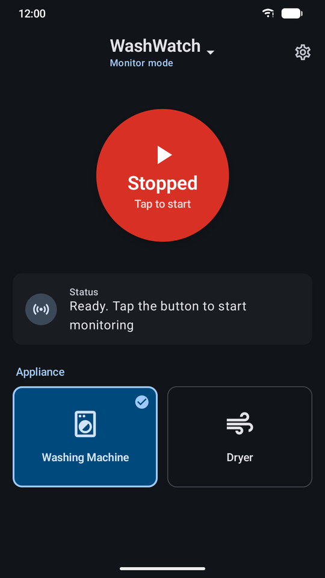
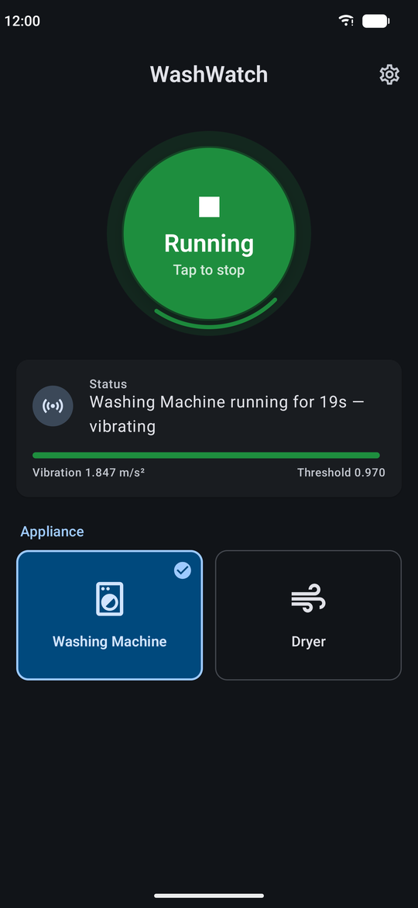
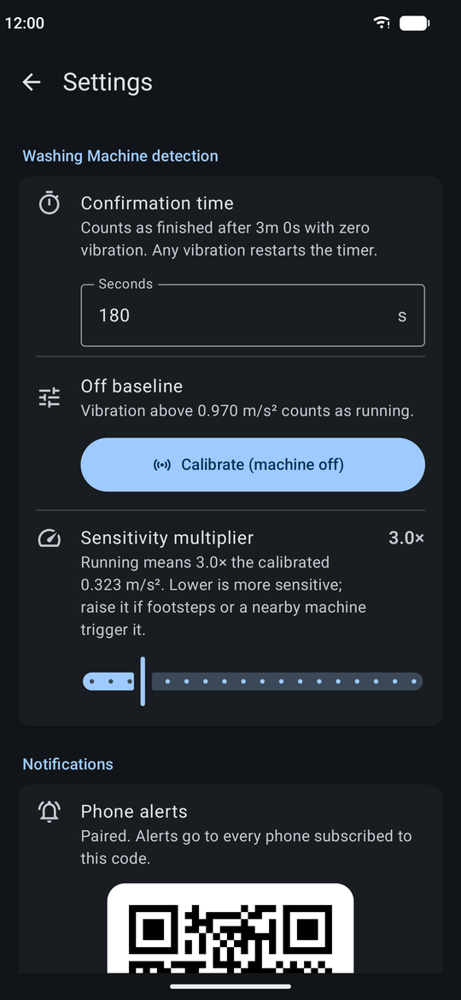

# WashWatch

The host app. It runs on a spare Android phone mounted to a washing machine or dryer, detects when a cycle starts and finishes from accelerometer vibration, and sends an alert to your phone.

**WashWatch in Monitor mode (this phone) → private ntfy.sh topic → WashWatch in Alerts mode (your phone)**. One app does both; switch modes from the menu under the app name.

See the [project README](../README.md) for the full story, screenshots and how detection works.

<p align="center">
  
  &nbsp;
  
  &nbsp;
  
</p>

## Requirements

- Android 8.0+ (API 26) with an accelerometer and an internet connection
- To build: JDK 21 and Android Studio Narwhal 3 Feature Drop (2025.1.3) or newer

## Install

Download `WashWatch-v1.0.apk` from the [latest release](https://github.com/mathewvarghesemanu/washwatch/releases/latest) and open it on the phone (allow *Install unknown apps*), or run `adb install WashWatch-v1.0.apk`.

To build from source instead:

```bash
./gradlew assembleDebug
adb install -r app/build/outputs/apk/debug/app-debug.apk
```

Or open this folder in Android Studio and press **Run**.

## Setup

1. Mount the phone firmly on the machine and keep it plugged in.
2. Pick *Washing Machine* or *Dryer* on the home screen.
3. In *Settings*, tap **Calibrate (machine off)** while the machine is idle. Adjust the confirmation time if your machine pauses for long stretches mid-cycle.
4. In *Settings → Notifications*, tap **Pair a phone** and scan the QR code from WashWatch in Alerts mode on your phone. Tap **Send test** to check it arrives.
5. Tap the big button to start monitoring.

## Security note

ntfy.sh topics are public to anyone who knows the name. This app generates a random 16-character topic (`washwatch-…`), and that name is the only secret. Don't share screenshots of the pairing QR code or code. To rotate it, tap **New code** under *Pair a phone* and re-pair your phone.
