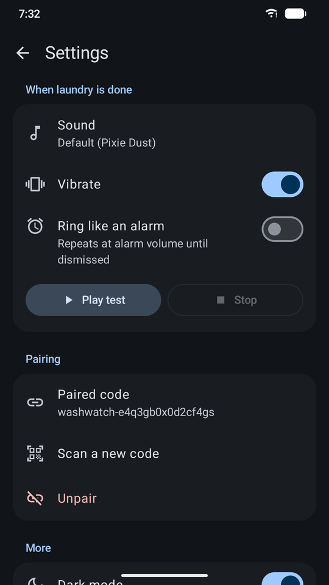

# WashWatch Alerts

The companion (client) app for [WashWatch](../WashWatch). WashWatch runs on the phone stuck to the washer or dryer (the **host**). WashWatch Alerts runs on your everyday phone (the **client**) and buzzes when a cycle starts or finishes.

**[WashWatch](../WashWatch) (host phone) → private ntfy.sh topic → WashWatch Alerts (this app)**

See the [project README](../README.md) for the full story and how detection works.

<p align="center">
  
  &nbsp;
  
  &nbsp;
  
  &nbsp;
  
</p>

## How it works

The host publishes to a private, randomly named [ntfy.sh](https://ntfy.sh) topic (`washwatch-…`). This app subscribes to that topic over a long-lived HTTPS stream (`/<topic>/json`) from a foreground service, and turns each message into a local notification. No account, Firebase or Google Play Services needed.

- **Pairing:** scan the QR code the host shows under *Settings → Notifications → Pair a phone*. You can also scan it with the stock camera app (this app handles `ntfy://ntfy.sh/washwatch-…` links), or type the pairing code by hand.
- **Missed alerts:** after a dropped connection or reboot, the app asks ntfy for everything since the last alert it saw and skips duplicates. ntfy.sh keeps messages for about 12 hours.
- **Priorities:** "done" alerts (priority 4–5) use a high-importance channel and "started" alerts (1–2) use a quiet one.
- **Done sound:** tap the gear to pick the "done" sound (a chime, alarm, ringtone, or silent), turn vibration on or off, and choose *Ring like an alarm* to keep ringing at alarm volume until you dismiss it. The default is the phone's notification sound with vibration. Android won't let an app change a channel's sound once it exists, so each change recreates the "done" channels under a new ID.
- **Cycle timer:** a "started" alert starts a timer, both in the app and in the notification. The timer shows how long the last cycle of that machine took and roughly when this one should finish. It clears when the "done" alert arrives, or after 3 hours.
- **Tidy history:** each "started" and "done" pair folds into one row showing the start and finish times and how long the cycle ran. Rows are grouped by day, and anything older than a week sits behind *Show older*. The "done" notification sums up the cycle the same way. Alerts delivered more than 15 minutes late, for example after a reconnect, arrive silently. Alerts more than 6 hours old go only to the history.
- **Dark theme** by default; switch it off in settings.
- **Reliability:** it reconnects with backoff (2 s → 60 s) and right away when the network returns. It restarts after a reboot or app update. Allow "unrestricted battery" when the app asks, so Doze doesn't delay alerts.

## Requirements

- Android 8.0+ (API 26) with an internet connection. A camera is optional, for QR pairing.
- To build: JDK 21 and Android Studio Narwhal 3 Feature Drop (2025.1.3) or newer

## Install

Download `WashWatchAlerts-v1.0.apk` from the [latest release](https://github.com/mathewvarghesemanu/washwatch/releases/latest) and open it on the phone (allow *Install unknown apps*), or run `adb install WashWatchAlerts-v1.0.apk`.

To build from source instead:

```bash
./gradlew assembleDebug
adb install -r app/build/outputs/apk/debug/app-debug.apk
```

Or open this folder in Android Studio and press **Run**.

## Security note

ntfy.sh topics are public to anyone who knows the name. The host's random 16-character topic is the only secret. To rotate it, tap **New code** on the host, then re-scan here.
